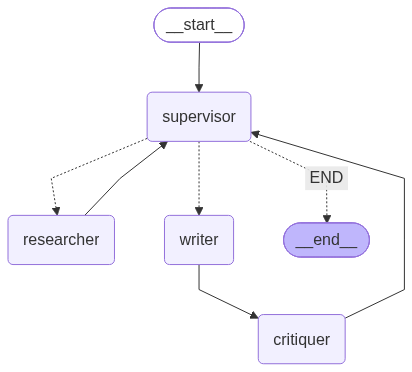
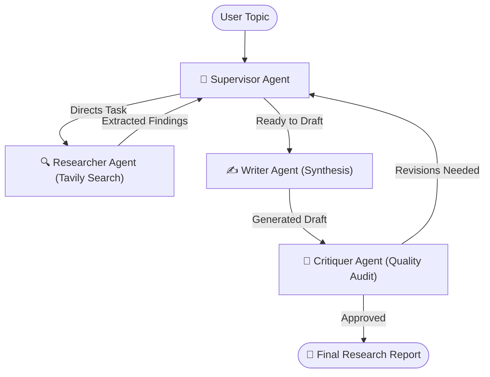

<div align="center">

# 🧠 Nexus Multi-Agent Research Assistant

### *An Autonomous Agent Swarm for Automated Deep Web Research & Synthesis*

[](https://www.python.org/)
[](https://langchain-ai.github.io/langgraph/)
[](https://python.langchain.com/)
[](https://streamlit.io/)
[](https://www.together.ai/)
[](https://tavily.com/)
[](LICENSE)

<br/>



<p align="center">
  <b>Supervisor</b> ➔ <b>Researcher</b> ➔ <b>Writer</b> ➔ <b>Critiquer</b> ➔ <b>Iterative Refinement Loop</b>
</p>

</div>

---

## 🌟 Overview

The **Nexus Multi-Agent Research Assistant** is an intelligent **Agent-to-Agent (A2A)** collaborative swarm designed to automate complex, in-depth research. Built on **LangChain** and **LangGraph**, it coordinates four specialized AI agents that autonomously gather real-time web intelligence, synthesize structured drafts, review publication standards, and iteratively refine until an approved, high-caliber report is produced.

---

## ✨ Features

- 🎯 **Four Specialized Autonomous Agents**:
  - **Supervisor**: Deconstructs research queries and directs workflow decisions dynamically.
  - **Researcher**: Gathers real-time web intelligence and sources using Tavily Search API.
  - **Writer**: Synthesizes structured, publication-grade markdown reports from raw data.
  - **Critiquer**: Rigorously audits depth, factual accuracy, and clarity, demanding revisions when needed.
- 🎨 **Modern Interactive UI**:
  - Glassmorphic design with custom typography (`Plus Jakarta Sans`).
  - **☀️ Light / 🌙 Dark Mode Switcher** with high-contrast elements.
  - **One-Click Topic Suggestions** for instant exploratory research.
- 📡 **Real-Time Live Swarm Activity Stream**:
  - Color-coded badges per agent with expandable findings and feedback logs.
- 📊 **Executive Analytics & Multi-Format Export**:
  - Word count, source packet tracking, review cycles, and reading time estimation.
  - Export reports instantly as **Markdown (`.md`)** or **Plain Text (`.txt`)**.
- 🔑 **Built-In API Credential Manager**:
  - Live **🧪 Test Keys** tool to verify connectivity before running.
  - One-click **💾 Save .env** persistence.

---

## 🤖 Multi-Agent Workflow



| Agent | Icon | Role | Technology |
| :--- | :---: | :--- | :--- |
| **Supervisor** | 🎯 | Orchestrates workflow, breaks down tasks, and delegates steps | LangGraph + Together AI |
| **Researcher** | 🔍 | Queries web sources, parses articles, and compiles facts | Tavily Search API |
| **Writer** | ✍️ | Synthesizes findings into comprehensive reports | Together AI (`Mixtral-8x7B`) |
| **Critiquer** | 🔎 | Quality audits reports and enforces publication standards | Together AI (`Mixtral-8x7B`) |

---

## 🚀 Quickstart Guide

### 1. Prerequisites

- **Python 3.12+** installed ([Download Python](https://www.python.org/downloads/))
- **Git** installed ([Download Git](https://git-scm.com/))
- Free API Keys:
  - **Together AI API Key**: Sign up free at [together.ai](https://www.together.ai/) *(powers the LLM)*
  - **Tavily Search API Key**: Sign up free at [tavily.com](https://tavily.com/) *(1,000 free searches/month)*

---

### 2. Clone the Repository

```bash
git clone https://github.com/riteshkumxr/Multi-agent-research-assistant.git
cd Multi-agent-research-assistant
```

---

### 3. Create a Virtual Environment

#### Windows (PowerShell):
```powershell
py -3.12 -m venv .venv
.\.venv\Scripts\Activate.ps1
```

#### macOS / Linux:
```bash
python3 -m venv .venv
source .venv/bin/activate
```

---

### 4. Install Dependencies

```bash
pip install -r requirements.txt
```

---

### 5. Configure API Credentials

Create a `.env` file in the project root:

```bash
# Windows
Copy-Item .env.example .env

# macOS / Linux
cp .env.example .env
```

Open `.env` and fill in your keys:

```env
TOGETHER_API_KEY=your_together_api_key_here
TAVILY_API_KEY=tvly-your_tavily_api_key_here
```

> **Note**: You can also enter or test your keys directly within the Streamlit sidebar web interface without modifying `.env` manually!

---

### 6. (Optional) Run the Test Suite

Verify that all agent tools and execution chains pass:

```bash
pytest
```

---

### 7. (Optional) Generate Graph Topology Diagram

Generate an updated architecture diagram in `assets/research_graph.png`:

```bash
python visualize_graph.py
```

---

### 8. Launch the Web Application

Start the Streamlit dashboard:

```bash
streamlit run app.py
```

Open your browser at:
👉 **`http://localhost:8501`**

---

## 📁 Project Structure

```
Multi-agent-research-assistant/
├── assets/
│   └── research_graph.png      # Architecture workflow visualization
├── tests/
│   └── test_tools.py           # Unit tests for agents & toolchains
├── .env.example                # Template for environment credentials
├── .gitignore                  # Prevents secrets & virtualenvs from leaking
├── agents.py                   # Agent definitions (Supervisor, Researcher, Writer, Critiquer)
├── app.py                      # Modern Streamlit UI with Dark/Light theme switching
├── graph.py                    # LangGraph StateGraph orchestration
├── prompts.py                  # Engineered prompts for each agent persona
├── pyproject.toml              # Project metadata & package configurations
├── requirements.txt            # Python dependencies
└── visualize_graph.py          # Generates graph topology diagram
```

---

## 🛠️ Troubleshooting

<details>
<summary><b>1. Error: "Together AI: Error code 401 - Invalid API key provided"</b></summary>
<br/>
Make sure you copied your key from <a href="https://api.together.ai/settings/api-keys">Together AI API Keys</a>. Together AI keys are 64-character hexadecimal strings (e.g., <code>8f7b...</code>) and do <b>not</b> start with <code>key_</code>.
</details>

<details>
<summary><b>2. Error: "No final report was generated. Please verify your API key credits and retry"</b></summary>
<br/>
Open the sidebar in the web app and click <b>🧪 Test Keys</b>. This will diagnose whether Together AI or Tavily has exhausted its free quota.
</details>

<details>
<summary><b>3. PowerShell Execution Policy Restriction</b></summary>
<br/>
If PowerShell prevents activating the virtual environment, run:
<pre><code>Set-ExecutionPolicy -ExecutionPolicy RemoteSigned -Scope CurrentUser</code></pre>
</details>

---

## 📜 License

This project is licensed under the **MIT License** — feel free to modify and build upon it!

---

<div align="center">
  <sub>Built with ❤️ using <b>LangGraph</b>, <b>Together AI</b>, and <b>Tavily</b></sub>
</div>
